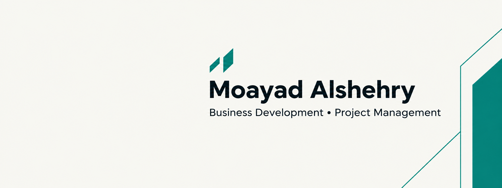

I'm an **Information Systems student at King Khalid University**, focused on **business development and project delivery**.

My project work connects product discovery, requirements, planning and implementation. I build practical software and automation tools, with an interest in how teams turn business needs into working products.

## Selected projects

| Project | Purpose and evidence |
| --- | --- |
| [AutoSemi](https://github.com/MoayadAlshehry/AutoSemi) | A published VS Code extension that automates routine semicolon insertion. [200+ Marketplace installs](https://marketplace.visualstudio.com/items?itemName=Moayad.AutoSemi), as of October 2026. |
| [Homelab Sentinel](https://github.com/MoayadAlshehry/homelab-sentinel) | A dashboard I actively use for service health, Docker operations, network visibility and alerts on Raspberry Pi 5. |
| [AI Database Builder](https://github.com/MoayadAlshehry/ai-database-builder) | Translates project requirements into reviewable MySQL schema proposals, with explicit approval before creation. |
| [LLM Resume Parser](https://github.com/MoayadAlshehry/llm-resume-parser) | Extracts resume information into inspectable JSON through a locally configurable model endpoint. |
| [Wake-on-LAN API](https://github.com/MoayadAlshehry/Wake-on-LAN-API) | A Raspberry Pi, Tailscale and Flask workflow for remotely waking a PC. |

## Product and venture experience

**Capstone Repository — Academic Review & Industry Discovery**  
Developing a bilingual platform that helps university capstone work remain discoverable and useful beyond graduation. It connects supervision, internal and independent assessment, faculty-led publication and controlled industry access, while preserving student attribution and institutional boundaries. Four-person capstone team; implementation is ongoing.

**SODUM — University-to-Career Venture**  
Founded a three-person venture focused on the university-to-career transition. Led product discovery, requirements and delivery planning through a pilot-ready, multi-portal MVP. Prepared a two-university pilot approach; the venture paused before user rollout.

## Connect

I'm interested in internships and early-career opportunities in **business development, project coordination and digital product delivery**.

[LinkedIn](https://www.linkedin.com/in/moayad-alshehry/)
