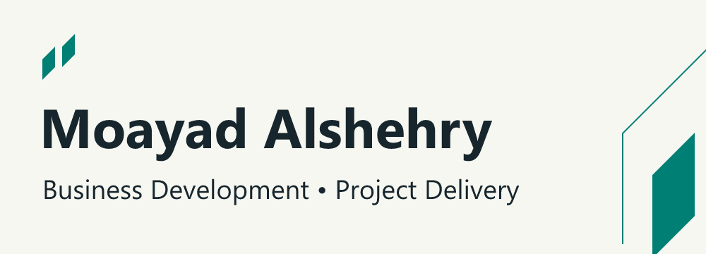
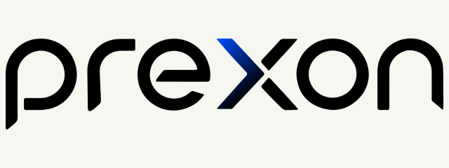
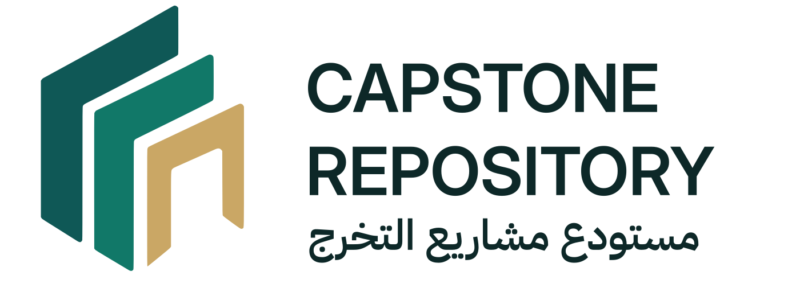
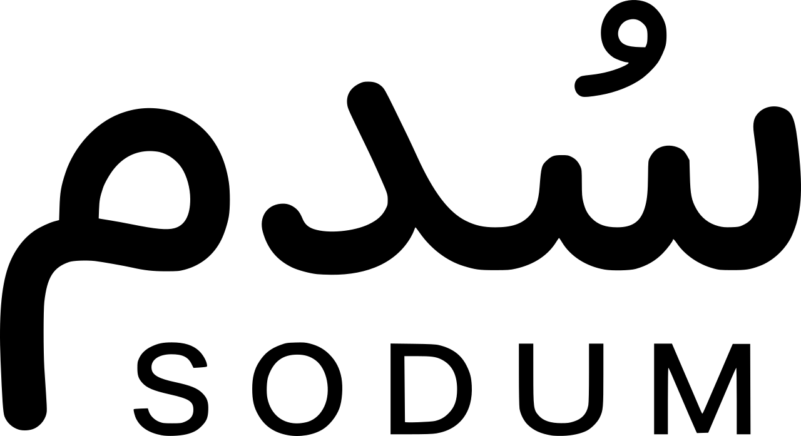

I'm an **Information Systems student at King Khalid University**, interested in **business development and project delivery**.

Through student and independent projects, I've gained experience in product discovery, requirements analysis, delivery planning and implementation. My technical background helps me connect business needs with practical solutions.

## Product and venture projects

### PREXON

**Ongoing independent startup project.** Technical solutions and consulting, from requirements to practical delivery. My work spans discovery, requirements, stakeholder coordination and planning. A delivered real estate and contract platform is one example of this work.

[Case study](case-studies/prexon.md)

### Capstone Repository

**Development ongoing, four-person team.** A bilingual platform designed to keep student work discoverable beyond graduation, connecting academic review, faculty-led publication and controlled industry discovery.

[Case study](case-studies/capstone-repository.md)

### SODUM

**Paused, pilot-ready MVP.** Founded a three-person university-to-career venture and led discovery, requirements and delivery planning. Prepared a two-university pilot approach before user rollout.

[Case study](case-studies/sodum.md)

## Software and automation

 **[AutoSemi](https://github.com/MoayadAlshehry/AutoSemi)**

A published VS Code extension for routine semicolon insertion. [200+ Marketplace installs](https://marketplace.visualstudio.com/items?itemName=Moayad.AutoSemi), as of October 2026.

 **[Homelab Sentinel](https://github.com/MoayadAlshehry/homelab-sentinel)**

A dashboard I actively use on Raspberry Pi 5 for service health, containers, network visibility and alerts.

 **[AI Database Builder](https://github.com/MoayadAlshehry/ai-database-builder)**

A Java CLI that turns requirements into reviewable MySQL schema proposals, with explicit approval before creation.

 **[LLM Resume Parser](https://github.com/MoayadAlshehry/llm-resume-parser)**

A Streamlit tool for structured PDF resume extraction, typed validation and JSON download.

 **[Wake-on-LAN API](https://github.com/MoayadAlshehry/Wake-on-LAN-API)**

A private, authenticated Raspberry Pi and Tailscale workflow for waking a remote PC.

## Professional development

Completed **[Decoding DevOps – From Basics to Advanced Projects with AI](https://www.udemy.com/course/decodingdevops/)** on Udemy, taught by Imran Teli. This coursework supports my understanding of infrastructure, automation and software delivery workflows.

## Connect

I'm seeking internships and early-career opportunities in **business development, project coordination and digital product delivery**.

[LinkedIn](https://www.linkedin.com/in/moayad-alshehry/)
