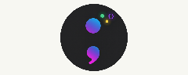
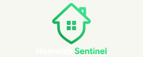
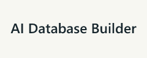
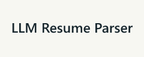
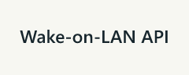
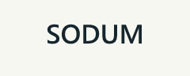

I'm an **Information Systems student at King Khalid University**, interested in **business development and project delivery**.

Through student and independent projects, I've gained experience in product discovery, requirements analysis, delivery planning and implementation. My technical background helps me connect business needs with practical solutions.

## Selected projects

| Project | Purpose and evidence |
|---|---|
|  [**AutoSemi**](https://github.com/MoayadAlshehry/AutoSemi) | A published VS Code extension for routine semicolon insertion. [200+ Marketplace installs](https://marketplace.visualstudio.com/items?itemName=Moayad.AutoSemi), as of October 2026. |
|  [**Homelab Sentinel**](https://github.com/MoayadAlshehry/homelab-sentinel) | A dashboard I actively use for service health, containers, network visibility and alerts on Raspberry Pi 5. |
|  [**AI Database Builder**](https://github.com/MoayadAlshehry/ai-database-builder) | Turns project requirements into reviewable MySQL schema proposals, with explicit approval before creation. |
|  [**LLM Resume Parser**](https://github.com/MoayadAlshehry/llm-resume-parser) | Extracts PDF resume information into validated, inspectable JSON through a configurable model endpoint. |
|  [**Wake-on-LAN API**](https://github.com/MoayadAlshehry/Wake-on-LAN-API) | A Raspberry Pi, Tailscale and authenticated Flask workflow for remotely waking a PC. |

## Product and venture experience

**SODUM — University-to-Career Venture**

Founded a three-person venture focused on the university-to-career transition. Led discovery, requirements and delivery planning for a pilot-ready, multi-portal MVP. Prepared a two-university pilot approach; the venture paused before user rollout.

**Capstone Repository — Academic Review & Industry Discovery**

Developing a bilingual platform within a four-person capstone team. The platform connects supervision, assessment, faculty-led publication and controlled industry discovery, preserving student attribution and institutional boundaries. Implementation is ongoing.

## Connect

I'm seeking internships and early-career opportunities in **business development, project coordination and digital product delivery**.

[LinkedIn](https://www.linkedin.com/in/moayad-alshehry/)
