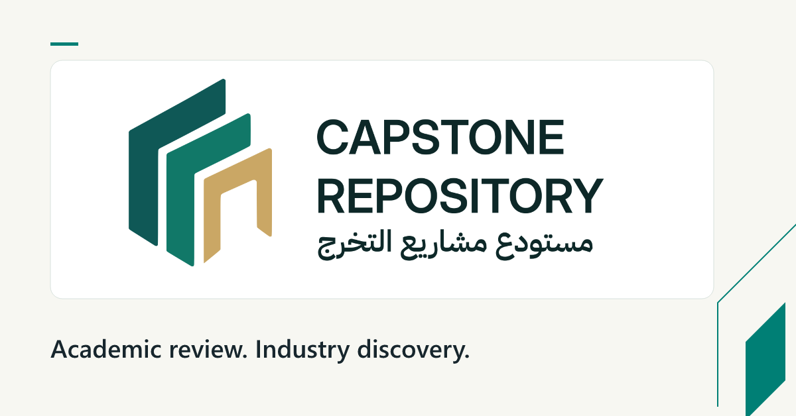
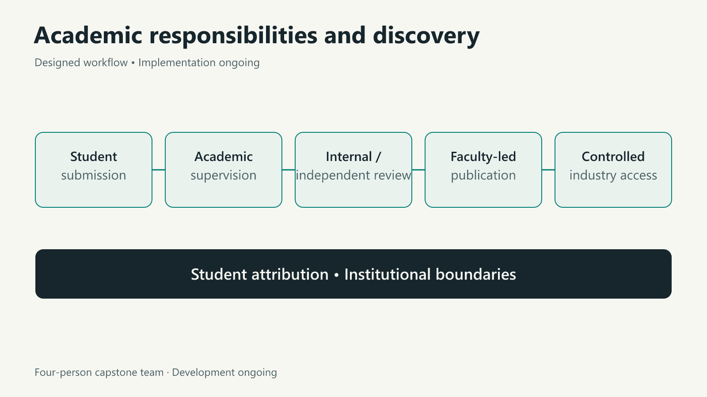

# Capstone Repository

**Four-person university capstone team · Development ongoing**

## Problem

University capstone work can become difficult to discover after graduation. Making it useful to academic reviewers and industry also requires clear responsibilities, student attribution and institutional boundaries.

## Project contribution

The project connects business analysis, requirements and workflow design with product development. Its designed academic workflow spans supervision, internal and independent assessment, faculty-led publication and controlled industry discovery.

## Design scope

The bilingual platform is designed around the responsibilities of students, supervisors, reviewers, faculty and industry users. Publication and access remain governed by the institution.

The visual represents the platform's designed workflow. Implementation is ongoing.

## Current status

Implementation is ongoing within the four-person team. This public case study shares the project design; source code and institutional records remain private.

[Back to the portfolio](../README.md) · [LinkedIn](https://www.linkedin.com/in/moayad-alshehry/)
