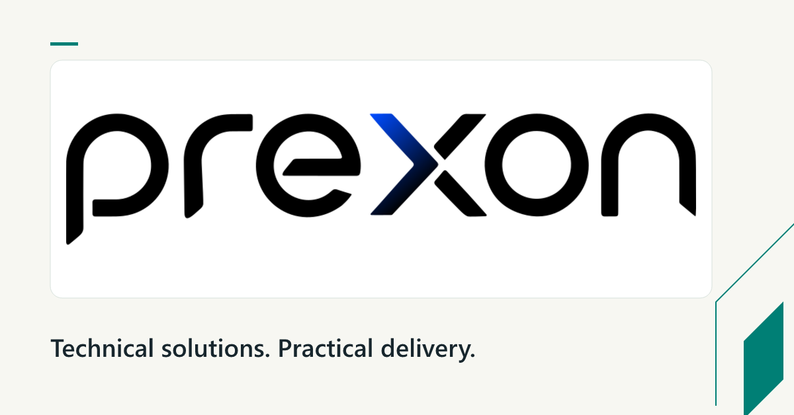
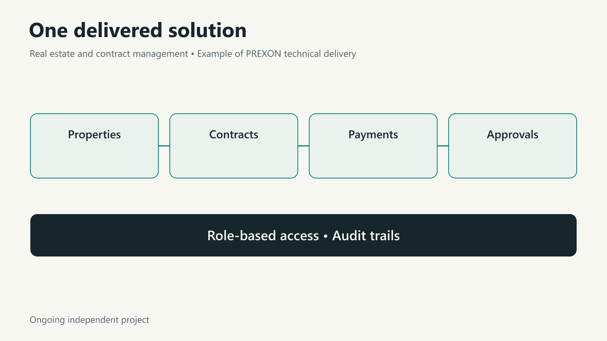

# PREXON

**Ongoing independent software project · January 2026–present**

## Problem

Businesses need technical solutions that fit their processes, constraints and goals. PREXON provides technical solutions and consulting services, connecting early requirements with practical implementation.

## Contribution

My work spans product discovery, requirements definition, stakeholder coordination and delivery planning, translating business needs into practical platform capabilities.

## Delivered example

One delivered solution is a real estate and contract management platform covering properties, contracts, payments and approvals, with role-based access and audit trails. This is one example within PREXON's broader technical solutions and consulting work.

The visual groups the implemented capabilities of this example platform.

## Current status

PREXON remains an ongoing independent startup project alongside my Information Systems degree. Source code and client records remain private.

[Official PREXON website](https://prexon.io/)

[Back to the portfolio](../README.md) · [LinkedIn](https://www.linkedin.com/in/moayad-alshehry/)
