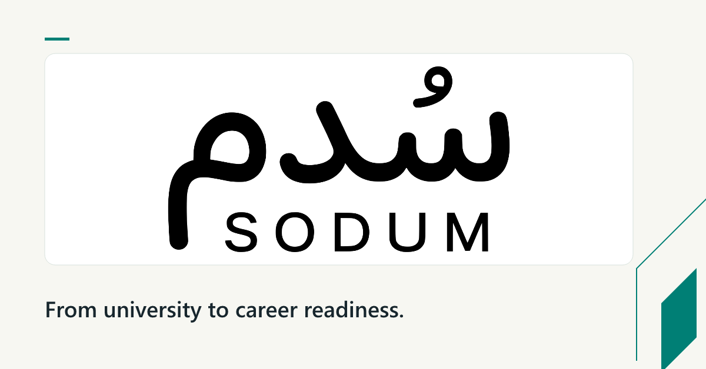
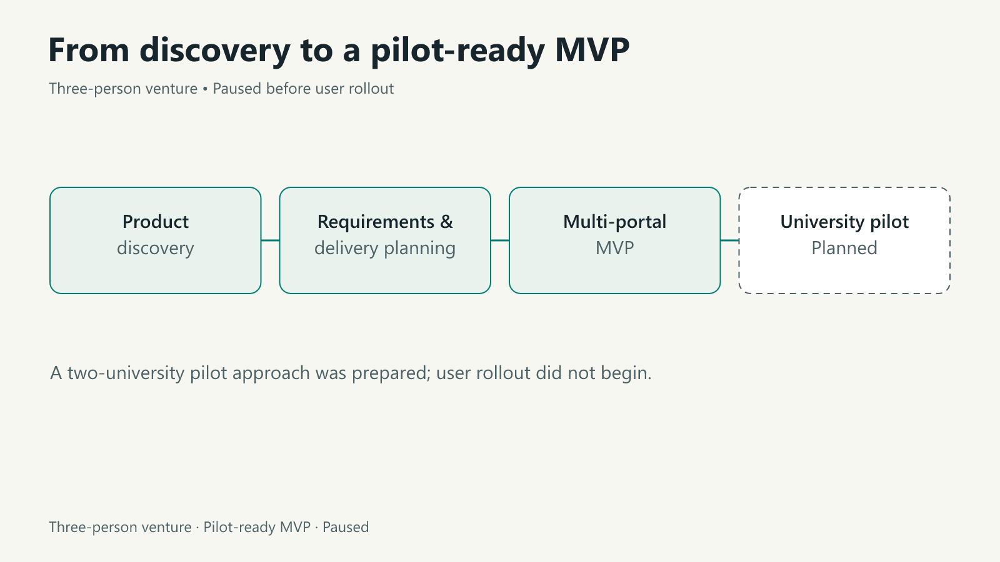

# SODUM

**Three-person venture · Pilot-ready MVP · Paused before user rollout**

## Problem

The transition from university to employment needs a clearer connection between student needs, career preparation and the stakeholders supporting that journey.

## Contribution

Founded the venture with a three-person team. Led product discovery, requirements definition and delivery planning for a multi-portal MVP.

## Deliverables

Developed the concept into a pilot-ready MVP and prepared a two-university pilot approach.

## Current status

The venture paused before user rollout, with the university pilot still at the planning stage. Source code remains private.

[Back to the portfolio](../README.md) · [LinkedIn](https://www.linkedin.com/in/moayad-alshehry/)
